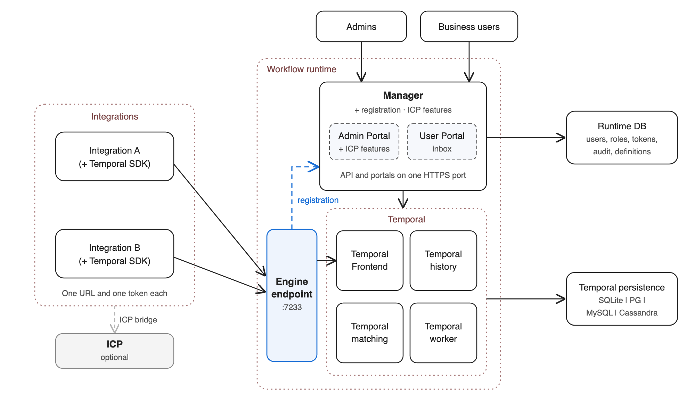

# Architecture

The Workflow Runtime runs WSO2 Integrator's durable workflows. It embeds the open-source Temporal server and adds
what a supported product needs around it: one endpoint for integrations, administration, sign-in and roles,
portals, packaging and updates.

## Components

| Component | What it is | Status |
|---|---|---|
| Engine | Temporal's four services (frontend, history, matching, worker) in our Go binary, `workflow-engine` | Builds and runs |
| Engine endpoint | The integrations' one port (7233): gRPC to Temporal's frontend, `/runtime/...` HTTPS to the Manager | Planned |
| Launcher | Starts the components of a profile, writes Temporal's configuration from `conf/runtime.toml`, supervises and restarts | Planned |
| Manager | Go service: engine administration, the Workflow Management API, SSO sign-in, roles; serves the portals | Planned |
| Admin Portal | UI for administrators and operators, at `/admin` | Planned |
| User Portal | Business users' human-task inbox, at `/portal` | Planned |
| Runtime DB | The Manager's data: integrations, definitions and versions, users, roles, audit | Planned |
| Temporal persistence | Temporal's data: workflow state, history, task queues, visibility | Configured by the launcher |

## How the pieces connect

1. **Integrations run workflows.** An integration uses the `ballerina/workflow` module, which embeds the Temporal
   SDK. Its workers connect to the engine endpoint over gRPC, with TLS and a token the runtime issues, and poll
   their task queues through it.
2. **Integrations register** (later, with a workflow module release): at startup the module sends its workflow
   definitions to `/runtime/register` on the same host and port, with the same token. On plain Temporal the call
   fails and the module carries on. Liveness comes from Temporal's task-queue pollers, so there is no heartbeat.
3. **People use the portals**, which the Manager serves on the same HTTPS port as its API.
4. **The Manager drives Temporal** through the Temporal Go SDK, via the frontend.
5. **Each side keeps its own database**: the Manager's Runtime DB, and Temporal persistence.

Inside Temporal the four services are separate microservices started from one binary. They find each other
through Temporal's membership ring and talk over internal gRPC. Temporal's worker service runs Temporal's own
housekeeping; integration workers never connect to it.

## Engine

- `engine/cmd/workflow-engine` is a thin `main`; the logic is in `engine/internal/cli`. It loads a Temporal server
  configuration and starts the services passed with `--service` (all of them by default) through
  `temporal.NewServer`, as Temporal's own `cmd/server` does.
- Temporal is a pinned Go module dependency (`engine/go.mod`), not copied source. Extension points are Temporal's
  public server options and plugin registration. See [0001](../decisions/0001-temporal-packaging.md).
- **Secure by default.** The engine refuses to start with no authorizer unless `--allow-no-auth` is given, which
  is for development and tests only. Production uses Temporal's JWT authorizer trusting the Manager's keys, over
  TLS.
- `workflow-engine-sql` creates and upgrades Temporal's schema, built from the same Temporal version.

## Profiles

One distribution; each node runs the profiles it is given (launcher, planned).

| Profile | Starts |
|---|---|
| `all` (default) | Everything on one machine |
| `engine` | The four Temporal services and the engine endpoint |
| `frontend`, `history`, `matching`, `worker` | One Temporal service (`frontend` includes the engine endpoint) |
| `manager` | The Manager, with the portals it serves |

## Data

| Database | Holds | Engines |
|---|---|---|
| Runtime DB | Integrations, definitions and versions, users, roles, token records, audit | PostgreSQL, MySQL; SQLite for trying out |
| Temporal persistence | Workflow state and history, task queues, visibility; namespace retention applies here | PostgreSQL, MySQL, Cassandra; SQLite for trying out |

Both can share one database server, in separate schemas.

## Security model

- Integrations authenticate to the engine endpoint with namespace tokens issued by the Manager, optionally bound
  to a task queue. Temporal's default authorizer is namespace-wide; the engine will add its own authorizer that
  limits each token to its task queue.
- People sign in through OIDC against the customer's identity provider. Roles are scoped to the runtime, a
  namespace or an integration.
- Every API route checks roles and permissions, whichever UI or script calls it.

## Why Go

- Temporal's server is written in Go and can be embedded as a library: our own binary, our version, Temporal
  pinned in one file, and Temporal's extension points (authorization, persistence plugins, interceptors), which
  exist only in Go.
- Dependency and Go toolchain fixes ship from our `go.mod` without waiting for a Temporal release.
- The Manager is Go as well, so the distribution is one runtime: static binaries, one minimal image, one set of
  security scans.

## Decisions

- [0001 Packaging and patching Temporal](../decisions/0001-temporal-packaging.md)
- [0002 Licensing and notices](../decisions/0002-licensing.md)
